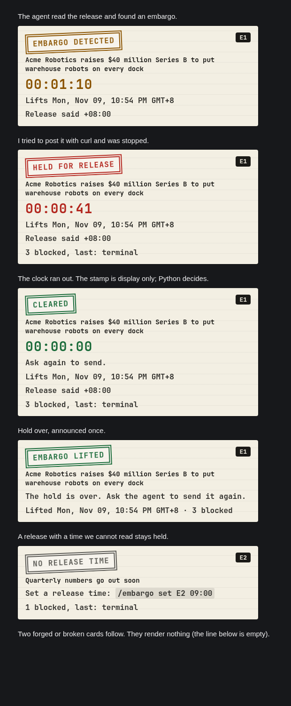

# Embargo

**Embargoed news stays embargoed.** When your Hermes agent reads "EMBARGOED UNTIL 9:00 a.m. ET, Nov 12", no tool can send that text out until the clock passes. A countdown stamp shows what is held. When the time comes, the hold lifts by itself.



*The real card code in a test page with a frozen clock, not Hermes Desktop itself.*

## Why

A press release or advisory often carries a release time. An agent that reads it can "helpfully" post it early: one curl, one `send_message`, one attached file. Existing guards look at secrets or untrusted input. This one looks at **time**, and it opens on its own.

## Install

```
hermes plugins install https://github.com/inkandwire/hermes-embargo
hermes plugins enable embargo
```

For the countdown card in Hermes Desktop, switch on the Desktop part of **Embargo** in Capabilities → Plugins. Without it you get a one-line text card; everything else works the same.

## Use

Nothing to configure. The agent reads a file, a page or a pasted message that has a header line, and Embargo takes over.

A header line looks like `EMBARGOED UNTIL 9:00 a.m. ET, Nov 12, 2026`.

Headers (at the start of a line): `EMBARGOED UNTIL`, `UNDER EMBARGO UNTIL`, `EMBARGO:` and `HOLD FOR RELEASE` (these two need a readable time), `NOT FOR RELEASE BEFORE|UNTIL`. Times: ISO 8601 with an offset, `9:00 a.m. ET, Nov 12, 2026`, `11/14/24 12 P.M. ET`, `7:30AM ET, March 18` (no year: the next such date), `09:00 MYT, 12 November 2026`, `UTC-5`, and common zone names (ET, EST, PT, CET, MYT and more; two different zones on one line count as unreadable). If the time cannot be read, the text stays held until you set one.

While an embargo is active, any tool call is blocked if it carries:

- 6 or more words in a row from the release (copies, quotes, URL-encoded, fullwidth, other case, line breaks),
- the name of a held file, or a file the agent saved with held text in it,
- **key facts**: a name and a figure from the release together, so "Acme just landed $40M" is held even when reworded.

Blocked calls get a message with the id, label and lift time. The matched text is never echoed back. Local file tools (`read_file`, `write_file`, `patch`, `search_files` and similar) are allowed, so the agent can still save a draft.

You stay in charge, in chat:

```
/embargo list
/embargo add "Project Falcon launches Friday" until +90s
/embargo set E1 09:00 MYT, 12 November 2026
/embargo lift E1
/embargo clear-lifted
```

The agent has two tools, `embargo_add` and `embargo_status`. It can add a hold. It cannot lift one.

## Safety

- **No network, no telemetry, no LLM calls.** Python standard library only.
- State lives in the plugin data folder: label, release time, file paths, and hashes of 6-word runs, names and figures. **Never the raw release text.** (The one-line label is plain text.)
- Hooks: `pre_tool_call` (block), `post_tool_call` and `pre_llm_call` (detect), `transform_llm_output` (card). One short context line per embargo: label and time only. Set `EMBARGO_REMINDER=off` to drop that context line and leave only the hard guard; this is for testing the guard, not for normal use.
- If the state file is unreadable while embargoes may exist, tool calls are blocked ("Embargo state unreadable"). With no embargoes, a plugin error allows the call.
- Agent calls that name the state files are blocked. This stops a confused agent, not a hostile one.

## Limits

- **A send guard, not a privacy filter.** Your model provider still sees whatever you let the agent read.
- It catches copies, quotes and reworded posts that repeat the headline names and figures. It is not a full paraphrase detector: a rewrite with no shared names or figures gets through.
- Text built some other way is not seen: base64 or other encodings, a script that reads the file, spelled-out numbers ("forty million"), look-alike letters (Cyrillic), and a paraphrase that drops the headline name or the figure.
- A copy shorter than 6 words in a row (for example 5-word chunks) is not matched.
- Detection reads file and web tool results and pasted messages. A header the agent never reads is not seen.
- Text after `-30-`, `###` or "About …" is not fingerprinted.
- The countdown is a display. Python decides what is held. Local clock only.

## Tests and demo

`python -m pytest -q tests` runs 70 tests with a fake clock and a temp data folder. `demo/DEMO.md` is the 70-second run: a loopback "wire" that prints posts as teletype text, and a release that lifts 70 seconds after you make it.

MIT license.
